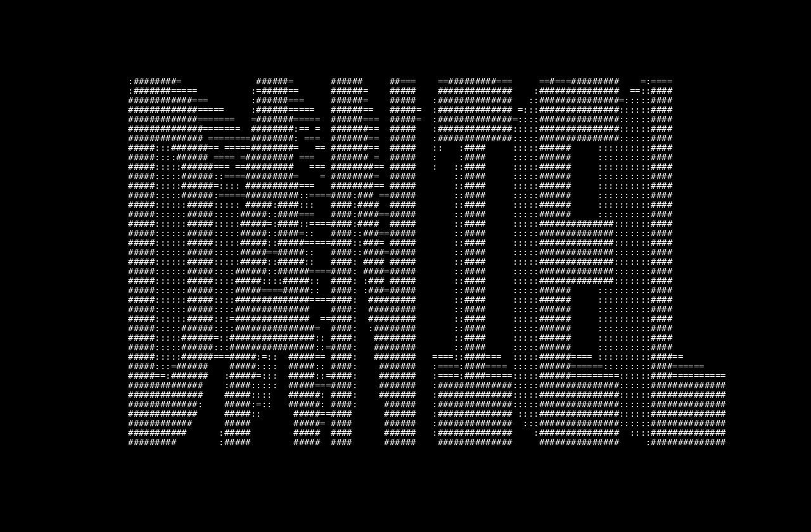

## Hi there, I'm Daniel 👋

Incoming Computer Science Honors student at Stony Brook University with a background in full-stack development, legacy systems migration, and practical AI applications. Currently engineering an AI-driven Sustainable Landcare Hub for ReWild Long Island. I am focused on software engineering, secure computing, and applying AI to real-world infrastructure. Always open to connecting about software systems, cybersecurity, or math!

## Tech Stack

**Programming & Markup Languages:** Python, JavaScript, TypeScript, Java, HTML/CSS, C#. Currently learning C++ and Rust!

**Frameworks, Libraries & Runtimes:** Hugging Face (BGE-M3), Gemma, React, Node.JS, Next.JS, JWT, Tailwind CSS, NumPy.

**Databases, Cloud & DevOps:** Google Cloud Platform, Docker, PostgreSQL & pgvector, MySQL, Supabase, Cloudflare, Microsoft IIS, Vercel. 

## 🌐 Socials <i>(Ctrl/Cmd + Click to open in a new tab)</i>
 

  
 
  
   

 

 

